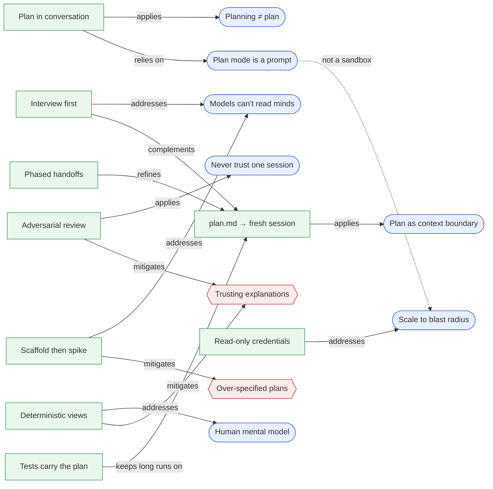

# Coding Agents Best Practices

Workflows, tools and pitfalls for planning with Claude Code and other coding agents, mined from one
article and its Hacker News discussion and stored as a linked graph of small Markdown notes:

- **Article:** [Plan mode is dead](https://www.aymannadeem.com/artificial/intelligence,/developer/tools/2026/09/24/plan-mode-is-dead.html) (Ayman Nadeem, 2026-09-24)
- **Discussion:** [HN item 49840054](https://news.ycombinator.com/item?id=49840054), 492 comments at last capture (2026-09-27), including a statement from the Claude Code team

**Interactive version:** the published site (built by CI from `main`), or locally with
`miner build` and `_site/index.html`: a map of the notes by meaning, each note with its
connections, search in your own words, and a **Compare** table with filters.

Every claim links to the comment it came from, and every quotation is checked word for word against
that comment. Start with the [playbook](#playbook), or use the [decision guide](#which-workflow-when)
to pick a workflow.

## Playbook

What held up across the thread, most useful first:

1. **Keep planning; drop the mode.** Plan mode in Claude Code is a reminder added to each message
   ([con-plan-mode-is-a-prompt](concepts/con-plan-mode-is-a-prompt.md)), so the sentence "discuss
   first, no code yet" does the same job. A standing rule in `CLAUDE.md` does it without you having
   to remember: [wf-conversational-planning](workflows/wf-conversational-planning.md),
   [template](templates/CLAUDE.planning.md).
2. **Have the agent interview you before it plans.** Smarter models still guess what you didn't say
   ([con-underspecification](concepts/con-underspecification.md)). Top-N questions, one at a time,
   then the assumptions it isn't asking about: [wf-interview-first](workflows/wf-interview-first.md).
3. **Big change? Write `plan.md` and implement it in a fresh session.** The file is the context
   reset, the handoff to a cheaper model, and the audit trail:
   [wf-plan-file-fresh-session](workflows/wf-plan-file-fresh-session.md).
4. **Don't trust a single session.** A second session without the first one's context (another
   model family is better still) reviews the plan, the diff and the explanation:
   [wf-adversarial-review](workflows/wf-adversarial-review.md).
5. **Keep plans short and about decisions.** Long generated prose hides the choices that matter
   ([con-ai-prose-fatigue](concepts/con-ai-prose-fatigue.md)). Leave implementation detail to the
   implementer ([ap-overspecified-plan](anti-patterns/ap-overspecified-plan.md)). Where code shows
   intent better than prose, scaffold it:
   [wf-scaffold-then-spike](workflows/wf-scaffold-then-spike.md).
6. **Match the ceremony to the blast radius.** Skip the plan for small reversible edits. Require one
   for auth, payments, schemas, data and prod
   ([con-blast-radius](concepts/con-blast-radius.md)), and put the real guardrails in permissions
   and credentials, not in a prompt ([wf-least-privilege-data](workflows/wf-least-privilege-data.md)).
7. **Understand the system through views you can trust.** Diagrams generated by scripts from the
   code can't drift or be invented ([wf-deterministic-views](workflows/wf-deterministic-views.md)).
   Treat an agent's explanation of its own code as a claim to check
   ([ap-trusting-explanations](anti-patterns/ap-trusting-explanations.md)).

## Which workflow when

| Situation | Start with | Then consider |
|---|---|---|
| Small, reversible change | Just ask | [wf-decomment-pass](workflows/wf-decomment-pass.md) before the PR |
| Unsure of the approach | [wf-feasibility-check](workflows/wf-feasibility-check.md) | [wf-spike-during-planning](workflows/wf-spike-during-planning.md) |
| Unsure what you want | [wf-interview-first](workflows/wf-interview-first.md) | [wf-prototype-as-clay](workflows/wf-prototype-as-clay.md) |
| Multi-file feature | [wf-conversational-planning](workflows/wf-conversational-planning.md) | [wf-plan-as-late-checkpoint](workflows/wf-plan-as-late-checkpoint.md), [wf-plan-file-fresh-session](workflows/wf-plan-file-fresh-session.md) |
| Codebase with strong patterns, linters and hooks | [wf-review-code-not-plans](workflows/wf-review-code-not-plans.md) | [wf-refactor-before-feature](workflows/wf-refactor-before-feature.md) |
| First plan looks too big | [wf-second-research-pass](workflows/wf-second-research-pass.md) | [ap-anchoring-on-first-choice](anti-patterns/ap-anchoring-on-first-choice.md) |
| Large or long-lived feature | [wf-staged-docs](workflows/wf-staged-docs.md) | [wf-spec-until-quiet](workflows/wf-spec-until-quiet.md), [wf-living-spec-dir](workflows/wf-living-spec-dir.md) |
| Multi-day or unattended run | [wf-phased-handoffs](workflows/wf-phased-handoffs.md) | [wf-test-harness-as-plan](workflows/wf-test-harness-as-plan.md), [wf-orchestrator-subagents](workflows/wf-orchestrator-subagents.md) |
| Touches data, auth or prod | [wf-least-privilege-data](workflows/wf-least-privilege-data.md) | [con-blast-radius](concepts/con-blast-radius.md) |
| Agent going in circles | [wf-plan-to-escape-spiral](workflows/wf-plan-to-escape-spiral.md) | [wf-adversarial-review](workflows/wf-adversarial-review.md) |
| Losing track of the codebase | [wf-deterministic-views](workflows/wf-deterministic-views.md) | [wf-explainer-artifacts](workflows/wf-explainer-artifacts.md), [wf-human-authored-spec](workflows/wf-human-authored-spec.md) |
| Want a record of why | [wf-decision-log](workflows/wf-decision-log.md) | [wf-living-spec-dir](workflows/wf-living-spec-dir.md) |

## Map

The core of the graph. The full graph (every node and edge) is in the site's Map and Connections views.



## Layout

| Path | Contents |
|---|---|
| [sources/](sources/) | Source notes: the article and the thread |
| [concepts/](concepts/) | Ideas and tensions |
| [workflows/](workflows/) | Practices you can adopt, with steps and prompts |
| [tools/](tools/) | Built-in and third-party tools |
| [anti-patterns/](anti-patterns/) | What went wrong for people |
| [templates/](templates/) | Ready-to-copy `CLAUDE.md` rules, plan/handoff docs, skills, a read-only hook |
| [kb.json](kb.json) | The schema: note types, relations (with the types each may connect), comparison attributes |
| [.miner/state.json](.miner/state.json) | Which source items have been processed |

## How it works

This is an [information-miner](https://github.com/MentalGear/information-miner) knowledge base.
Each note stores only what someone wrote: its text, a one-line `summary`, typed `links` and
comparison attributes. Everything else is derived. The filename is the id, the folder the type,
the `# ` heading the title, the links in the text are its citations and mentions. Backlinks, the
index, compare tables, the graph and the site are built, never committed.

```bash
pip install "information-miner[semantic] @ git+https://github.com/MentalGear/information-miner@claude/wizardly-edison-u0o47b"
miner check --evidence      # schema, links, citations, and every quotation against its source
miner build                 # _site/: map, connections, reader, search, compare
miner search "how do I stop the agent from coding too early" --expand
miner show wf-plan-file-fresh-session
miner path ap-trusting-explanations tool-beads
miner eval eval.json        # search quality on questions phrased the way people ask them
```

CI runs `miner check` on every push and publishes the site from `main`
([.github/workflows/kb.yml](.github/workflows/kb.yml)).

## Updating from this or other sources

```bash
miner refresh                   # re-capture the thread and the article; writes a delta of unprocessed items
miner add <url>                 # a new source: any HN thread or web page
```

Then open Claude Code here and run **`/kb-update <url>`** (the plugin is enabled in
`.claude/settings.json`), or ask it to "refresh the sources and update the knowledge base". It reads
the delta, extends or creates notes, takes every quotation from the source with `miner quote`
instead of typing it, records contradictions as "Disputed" sections, then acks the items and runs
`miner check --evidence`. Nothing is lost if it stops halfway: items stay unprocessed until acked.

Behind a TLS-intercepting proxy, set `SSL_CERT_FILE` to the proxy's CA bundle.

## Caveats

This records what practitioners *reported* in one discussion on 2026-09-24/26. Much of it is
anecdote from people with different models, budgets and codebases. Third-party tools are listed,
not endorsed; read a skill or plugin before installing it, since it runs with your agent's
permissions.
